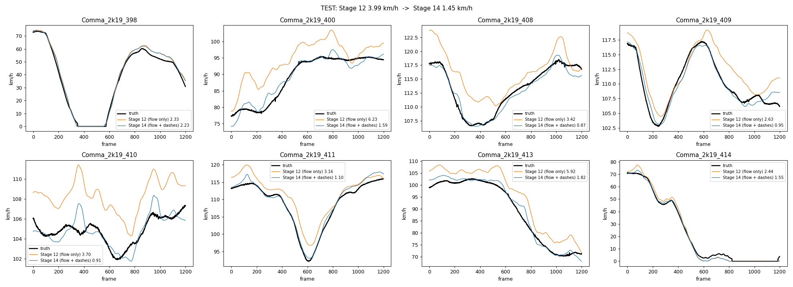
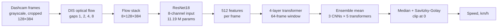
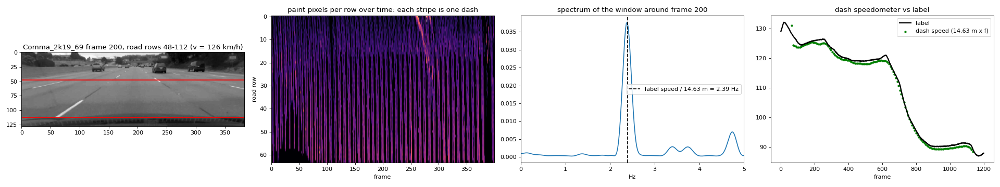
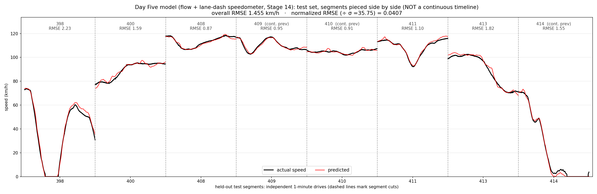

# Vehicle Speed Estimation from Dashcam Video

Predicts a car's speed in km/h from dashcam frames alone, using multi-gap optical flow, a ResNet18 and a temporal transformer. Solo project for a Deep Learning course at KMITL.


## Results

RMSE in km/h, lower is better. Validation scores unless marked TEST.

| Step | RMSE (km/h) |
|---|---|
| Predict the training mean | 41.39 |
| Single frame, ResNet18 | 9.06 |
| Optical flow only (gap 2) | 4.38 |
| Multi-gap flow (gaps 1, 2, 4, 8) | 3.12 |
| + temporal transformer, 3 CNNs × 5 transformers | 2.48 |
| **TEST, pre-registered model** | **3.99** |
| **TEST, later experiment with lane-dash scale** | **1.45** |

**How to read the two test numbers.** 3.99 is the pre-registered result: the model and its decision rules were frozen before the test set was touched. 1.45 comes from a later recipe that was designed and chosen on training and validation data only, but after the test set had already been used. The test labels were read three times in total (3.99, then 1.75, then 1.45). Only 3.99 was fixed in advance.



*All 8 held-out test clips. Orange: flow-only model (3.99). Blue: flow plus lane-dash scale (1.45). Black: ground truth.*

## The problem

Given only the images from a forward-facing dashcam, estimate the speed of the car at every frame. No GPS, no CAN bus and no other sensor columns are used as input.

- **Data:** [Comma2k19](https://github.com/commaai/comma2k19), 60 / 8 / 8 clips for training / validation / test (72,000 / 9,600 / 9,600 frames at 20 fps)
- **Target:** `car_speed_km_h`
- **Split:** by clip, never by frame

## How it works



1. **Motion, not appearance.** A single-frame model memorised scenes (9.06). Feeding only optical flow and hiding the image cut the error by half (4.38).
2. **Several time scales.** DIS optical flow is computed between frame *t* and frames *t*+1, +2, +4 and +8, giving an 8-channel input. Adding gap 16 made it worse.
3. **A model that uses time.** A frozen ResNet18 turns each flow stack into 512 features. A 4-layer transformer (3.31 M parameters) reads 64 frames (3.2 s) and predicts speed for each one.
4. **Ensemble and smoothing.** 3 CNN seeds × 5 transformer seeds are averaged, then smoothed and clipped at 0.

### The lane-dash speedometer (later experiment)

On the test set the flow-only model over-predicted every clip by about +3 km/h. That is a scale error, and optical flow cannot measure scale because pixel motion depends on camera height and angle as well as speed.

The images do contain a ruler: California broken lane lines repeat every 48 ft (14.63 m). A lane-line pixel therefore flickers at `f = speed / 14.63 m`, whatever the camera geometry. Reading that frequency from the frames gives an absolute speed without labels.



The final recipe averages two uses of this signal: a fusion transformer (3.44 M parameters) that takes flow features plus the dash spectrum, and the original ensemble rescaled by the dash speed. Test RMSE went from 3.99 to 1.45 and the mean bias from +3.0 to about +0.3 km/h.



## What I learned

- Seed noise is large. One CNN seed scored 2.33 on validation; across three seeds the honest figure is 2.60 ± 0.25. Several one-seed "improvements" were inside that noise.
- Validation did not predict the test bias. With 8 clips per split, a split can differ in ways the model was never tested on.
- A CNN's own validation score is a weak guide. The CNN with the best score gave one of the worst results after the transformer.

## How to run

The work was done in one notebook, with a Google Colab front end connected to a local Docker runtime on an RTX 3070 laptop GPU (8 GB).

1. Download [Comma2k19](https://github.com/commaai/comma2k19) and arrange it as `Training/`, `Validation/` and `Testing/`, each holding `Comma_2k19_<id>/` folders with the `.jpg` frames and a `labels.csv`.
2. Start a Colab local runtime with the dataset mounted read-only at `/data` and an empty folder mounted at `/cache`:

```bash
docker run --gpus=all -p 127.0.0.1:9000:8080 -v /path/to/comma2k19:/data:ro -v /path/to/cache:/cache us-docker.pkg.dev/colab-images/public/runtime
```

3. Open `dashcam_speed_estimation.ipynb` in Colab, connect to the local runtime and run the cells in order. Every code cell has a note above it saying what it does, what to look for and what was decided.

The cache (frames, flow, features, checkpoints) grows to tens of GB and is not part of this repo. To run outside Colab, install `requirements.txt` and change the `/data` and `/cache` paths.

## Project structure

```
dashcam-speed-estimation/
├── dashcam_speed_estimation.ipynb   # the full experiment log, with outputs
├── scripts/                         # standalone scripts the notebook writes and runs
│   ├── flow_mg.py                   # multi-gap DIS optical flow, in parallel
│   ├── dash_spectra.py              # lane-dash spectra from the frames
│   ├── dash_fuse.py                 # dash speed reading and per-clip rescaling
│   ├── train_fusion.py              # fusion transformer (flow features + dash spectra)
│   ├── final_combo.py               # final recipe: mean of the two methods
│   └── ...                          # checks and plotting
├── results/
│   ├── test_summary.txt             # pre-registered test run, per-clip RMSE and bias
│   ├── architecture.txt             # layer-by-layer tensor sizes
│   ├── figs/                        # result plots
│   └── logs/                        # training logs
└── requirements.txt
```

`flow_mg.py` is saved in its last state (gap 16 only). The notebook edits the gap tuple with `sed` between runs.

## Limitations

- The lane-dash method needs 48 ft broken lane lines, so it only applies to California-style highways. At stops, in slow traffic and on roads without them the model falls back to flow alone.
- The dash speed differs from the label by about 1.1 % per clip, roughly 1 km/h on the highway. That is the floor of this method.
- Scoring is offline: the dash windows and smoothing filters are centred, so a real car would need a causal version.
- Only 8 validation and 8 test clips, all from one dataset and one region.
- 1.45 is not a pre-registered number (see Results).

## Author

**Jitpanu Arunotai**, Robotics & AI Engineering, King Mongkut's Institute of Technology Ladkrabang (KMITL)
